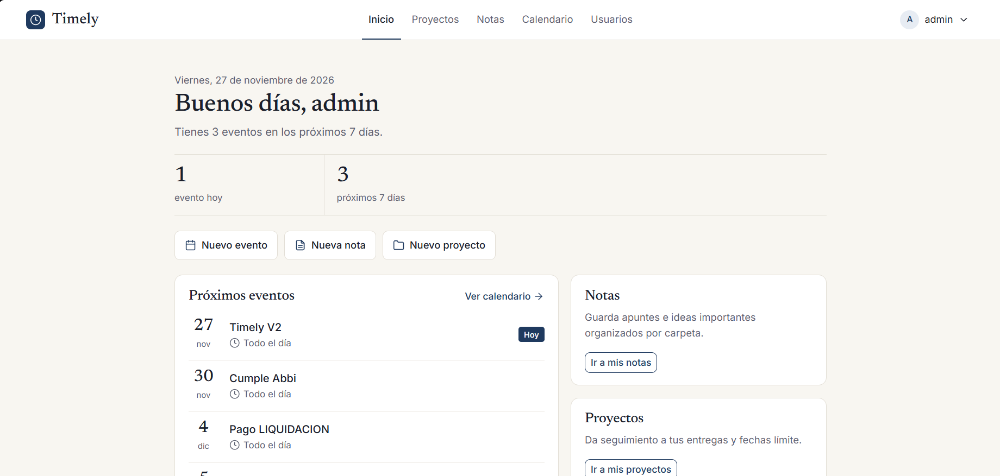
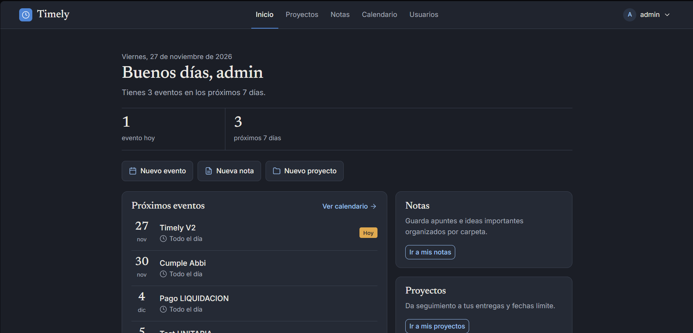
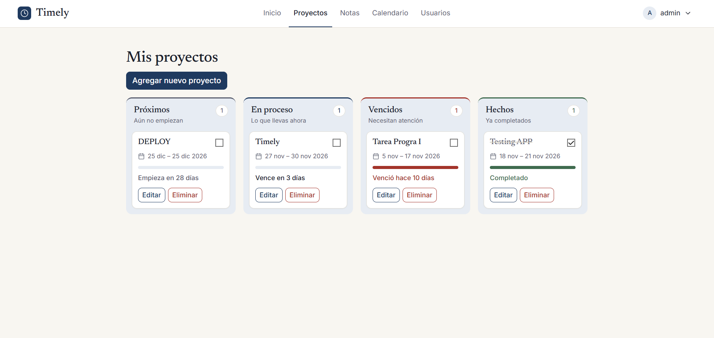
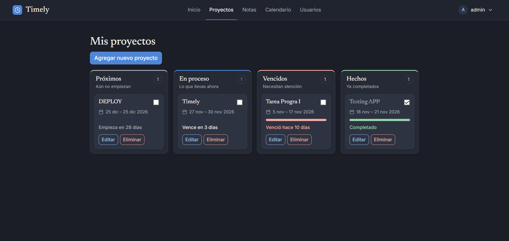
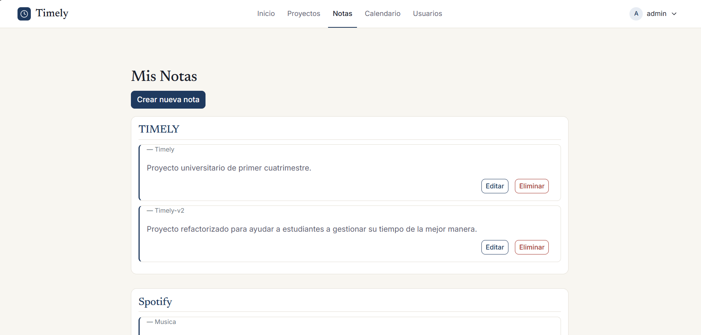
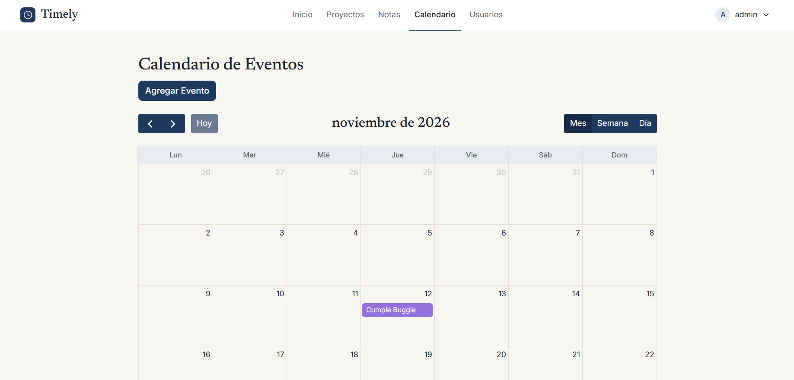
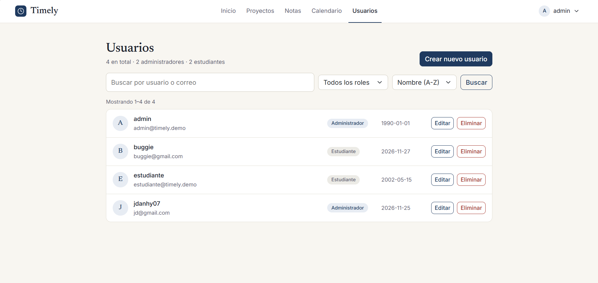
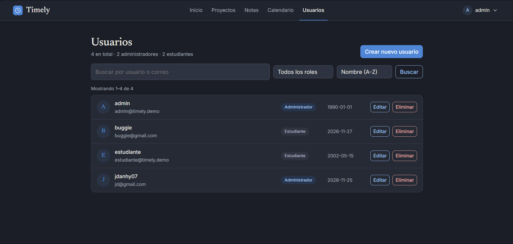

# 📚 Timely — Student Time Manager


**Planificador académico web** construido con **ASP.NET Core MVC (.NET 8)** que ayuda a los estudiantes a organizar proyectos, notas y eventos de calendario en un solo lugar, con autenticación de usuarios, control de roles y modo claro/oscuro.

<p align="center">
  
  
</p>

## 📑 Tabla de contenidos

- [Descripción](#-descripción)
- [Capturas de pantalla](#-capturas-de-pantalla)
- [Funcionalidades](#-funcionalidades)
- [Arquitectura y stack técnico](#-arquitectura-y-stack-técnico)
- [Estructura del proyecto](#-estructura-del-proyecto)
- [Requisitos previos](#-requisitos-previos)
- [Instalación y ejecución](#-instalación-y-ejecución)
- [Usuarios de demostración](#-usuarios-de-demostración)
- [Configuración](#-configuración)
- [Pruebas](#-pruebas)
- [Roadmap](#-roadmap)
- [Autor](#-autor)

## 🧭 Descripción

Timely nace como respuesta a un problema común entre estudiantes: la dificultad para organizar tareas, proyectos y fechas límite entre distintas materias. La aplicación centraliza esa información en un panel único, con vistas dedicadas para proyectos académicos, notas personales y un calendario interactivo de eventos.

El proyecto sigue el patrón **MVC** con una **capa de servicios desacoplada mediante interfaces** (inyección de dependencias), lo que facilita las pruebas, el mantenimiento y la futura extensión de funcionalidades.

> **Versión 2 (`timely-v2`):** rediseño visual sobrio y académico, modo oscuro propio, SQLite como base de datos predeterminada (sin instalar nada), datos de demostración, lista de usuarios con búsqueda y paginación, endurecimiento de seguridad y suite de pruebas con integración continua.

## 🖼 Capturas de pantalla

| Proyectos (modo claro) | Proyectos (modo oscuro) |
|---|---|
|  |  |

| Notas | Calendario |
|---|---|
|  |  |

| Usuarios — vista de administrador (modo claro) | Usuarios — vista de administrador (modo oscuro) |
|---|---|
|  |  |

## ✨ Funcionalidades

- 🔐 **Autenticación y roles** — Inicio de sesión con cookies, registro de estudiantes y rol `Administrador`. La sesión expira tras 20 minutos de inactividad (deslizante) y las contraseñas se guardan con hash (`PasswordHasher`).
- 🏠 **Panel de inicio** — Saludo según la hora, eventos de hoy y de los próximos 7 días, y accesos rápidos para crear eventos, notas y proyectos.
- ✅ **Gestión de proyectos** — Tablero en cuatro columnas (**Próximos**, **En proceso**, **Vencidos** y **Hechos**). El estado se calcula a partir de las fechas, muestra una barra de avance y cuántos días faltan o pasaron, y un casillero permite marcar un proyecto como completado.
- 📝 **Notas** — CRUD completo de notas organizadas por carpetas.
- 📅 **Calendario interactivo** — Eventos con fecha de inicio/fin y descripción, integrados con **FullCalendar**, con endpoints JSON para crear, editar y eliminar eventos de forma asíncrona.
- 👤 **Mi perfil** — Cada persona edita su usuario, correo y fecha, y cambia su contraseña sin poder tocar su propio rol.
- 🛡 **Gestión de usuarios (administradores)** — Lista con **búsqueda** por usuario o correo, **filtro por rol**, **orden** (nombre, más recientes, más antiguos) y **paginación**, resueltos con una consulta a la base de datos, de modo que sigue siendo ágil con cientos de usuarios. Incluye alta, edición y eliminación.
- 🌗 **Apariencia** — Tema **claro, oscuro o automático** (según el sistema) con una paleta propia para el modo oscuro, y opción de **texto grande**. Las preferencias se recuerdan en el navegador.
- 🔒 **Seguridad** — Token antiforgery en los POST, datos aislados por usuario, nombre de usuario y correo únicos, y acciones de administrador protegidas por rol.

## 🛠 Arquitectura y stack técnico

| Categoría | Tecnología |
|---|---|
| Framework | ASP.NET Core MVC (.NET 8) |
| Lenguaje | C# |
| Acceso a datos | Entity Framework Core 8 con **SQLite** (predeterminado) o **SQL Server** |
| Autenticación | Cookie Authentication + Authorization Policies |
| Frontend | Razor Views (`.cshtml`), Bootstrap, FullCalendar, CSS/JS propios |
| Tipografía | Inter y Newsreader, servidas localmente desde `wwwroot/fonts` |
| Pruebas | xUnit + SQLite en memoria |
| CI | GitHub Actions (compila y ejecuta las pruebas) |
| Patrón | MVC con capa de **Services** e **Interfaces** (inyección de dependencias) |

**Decisiones de diseño destacadas:**

- Separación de responsabilidades entre `Controllers`, `Services` (lógica de negocio) y `Data` (acceso a datos vía `ApplicationDbContext`).
- Cada servicio expone una interfaz (`IProyectoService`, `INotaService`, `IUsuarioService`, `ICalendarioService`), registrada en el contenedor de dependencias de `Program.cs`.
- El proveedor de base de datos se elige por configuración (`Database:Provider`), sin tocar código.
- El filtrado, el orden y la paginación de la lista de usuarios se hacen en la base de datos (`UsuarioService.Buscar`), con los comodines de `LIKE` escapados para que la búsqueda sea literal.
- El estilo usa variables CSS; el modo oscuro redefine esas variables en lugar de duplicar reglas.

## 📂 Estructura del proyecto

```
student-time-manager/
├── .github/workflows/    # Integración continua (compilar y probar)
├── docs/img/             # Capturas de pantalla del README
├── Timely/
│   ├── Controllers/      # Controladores MVC (Proyectos, Notas, Calendarios, Usuarios, Home)
│   ├── Data/             # DbContext, datos de demostración y configuración de EF Core
│   ├── Migrations/       # Migraciones de SQL Server
│   ├── Models/           # Entidades del dominio y modelos de vista
│   ├── Services/
│   │   └── Interfaces/   # Contratos de servicios (inyección de dependencias)
│   ├── Views/            # Vistas Razor organizadas por controlador
│   ├── wwwroot/          # Recursos estáticos (CSS, JS, fuentes, librerías)
│   ├── Program.cs        # Configuración de la aplicación (DI, auth, middlewares)
│   └── appsettings.json  # Configuración (proveedor de BD, cadenas de conexión, logging)
└── Timely.Tests/         # Pruebas xUnit (servicios, controladores y datos)
```

## ✅ Requisitos previos

- [.NET 8 SDK](https://dotnet.microsoft.com/download/dotnet/8.0)
- Un editor como Visual Studio 2022 o VS Code (opcional)
- *Solo si usas SQL Server:* SQL Server LocalDB (incluido con Visual Studio) o una instancia de SQL Server

Con SQLite, la opción predeterminada, **no necesitas instalar ninguna base de datos**.

## 🚀 Instalación y ejecución

```bash
# 1. Clonar el repositorio
git clone https://github.com/JDanhy07/student-time-manager.git
cd student-time-manager

git checkout timely

# 2. Restaurar dependencias
dotnet restore Timely/Timely.sln

# 3. Ejecutar la aplicación
cd Timely
dotnet run --launch-profile https
```

La aplicación queda disponible en **https://localhost:7177** (o en `http://localhost:5250`).

Al primer arranque, la base de datos `timely.db` se crea sola junto al proyecto y se llena con datos de demostración. **No hace falta aplicar migraciones.**

> Si el navegador advierte sobre el certificado de desarrollo, confía en él con `dotnet dev-certs https --trust`.

## 🔑 Usuarios de demostración

Se crean automáticamente al primer arranque en entorno de desarrollo, junto con proyectos, notas y eventos de ejemplo:

| Rol | Usuario | Contraseña |
|---|---|---|
| Administrador | `admin` | `Admin123` |
| Estudiante | `estudiante` | `Estudiante123` |

> ⚠️ Son credenciales **solo de demostración**: únicamente se siembran en desarrollo y solo si la base de datos está vacía. Para reiniciar los datos de ejemplo, detén la aplicación y borra el archivo `timely.db`.

También puedes crear tu propia cuenta de estudiante desde la pantalla de inicio de sesión.

## ⚙️ Configuración

La configuración está en `Timely/appsettings.json`:

```json
{
  "ConnectionStrings": {
    "Timely": "Data Source=(localdb)\\MSSQLLocalDB;Initial Catalog=Timely;Integrated Security=True;",
    "TimelySqlite": "Data Source=timely.db"
  },
  "Database": {
    "Provider": "Sqlite",
    "SeedDemoData": true
  }
}
```

| Clave | Valores | Descripción |
|---|---|---|
| `Database:Provider` | `Sqlite` (predeterminado) / `SqlServer` | Proveedor de base de datos. |
| `Database:SeedDemoData` | `true` / `false` | Siembra los datos de demostración (solo en desarrollo y con la base vacía). |
| `ConnectionStrings:TimelySqlite` | cadena de conexión | Ubicación del archivo SQLite. |
| `ConnectionStrings:Timely` | cadena de conexión | Conexión a SQL Server. |

### Usar SQL Server en lugar de SQLite

1. En `appsettings.json`, cambia `Database:Provider` a `"SqlServer"` y ajusta la cadena `Timely` a tu entorno.
2. Aplica las migraciones (con SQL Server el esquema se gestiona con EF Core Migrations; con SQLite se crea directamente desde el modelo):

```bash
cd Timely
dotnet ef database update
```

Para producción se recomienda mover las credenciales sensibles a variables de entorno o a un gestor de secretos (`dotnet user-secrets`). El archivo `timely.db` y `appsettings.Development.json` están en el `.gitignore` y no se suben al repositorio.

## 🧪 Pruebas

El proyecto incluye **55 pruebas** con xUnit sobre una base SQLite en memoria (usa el mismo `ApplicationDbContext` de la aplicación, así que el modelo real se valida). Cubren la lógica de los servicios, el aislamiento de datos entre usuarios, la autorización por rol, los índices únicos, los datos de demostración y la búsqueda y paginación de usuarios.

```bash
dotnet test Timely/Timely.sln
```

Cada `push` y cada *pull request* ejecutan además la compilación y las pruebas en **GitHub Actions** (`.github/workflows/ci.yml`).

## 🚧 Roadmap

- [x] Pruebas unitarias y de integración, con CI en GitHub Actions
- [x] Rediseño de la interfaz y modo oscuro
- [x] Lista de usuarios con búsqueda, filtros y paginación en base de datos
- [x] SQLite como base predeterminada y datos de demostración
- [ ] Notificaciones y recordatorios de proyectos próximos a vencer
- [ ] Demo publicada en línea

## 👤 Autor

**JDanhy07**
[GitHub](https://github.com/JDanhy07)